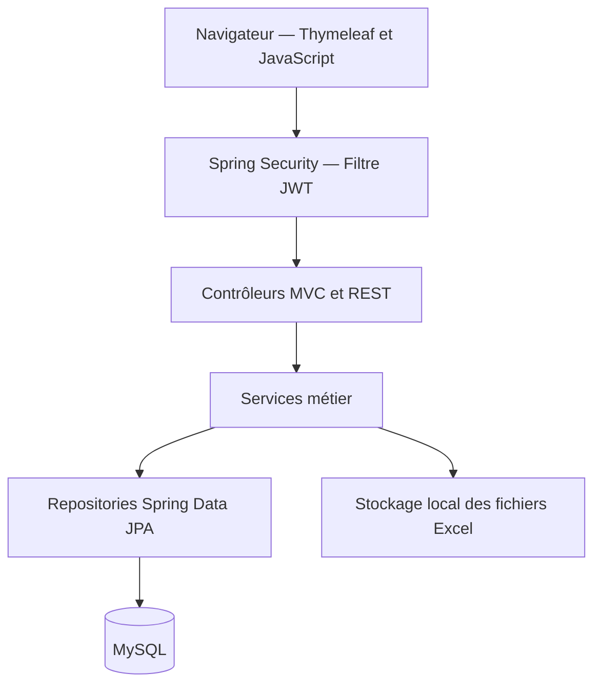

<div align="center">


# ONCF — Plateforme de gestion et de suivi du confort

**Supervision des techniciens · Évaluations · Analyse de données Excel**

Projet de stage de quatrième année en ingénierie informatique et réseaux.


[Présentation](#présentation) · [Fonctionnalités](#fonctionnalités) · [Architecture](#architecture) · [Installation](#installation-locale) · [Documentation](#rapport-et-documentation)

</div>

---

## Présentation

Cette application web a été réalisée par **Akram Lemaadni** dans le cadre d’un stage à l’**Office National des Chemins de Fer**, du **14 juillet au 30 août 2025**, durant la quatrième année du cursus d’ingénierie informatique et réseaux à l’EMSI.

Le projet porte sur la gestion des stagiaires et des techniciens, ainsi que sur le suivi du confort ferroviaire à partir de fichiers Excel.

La solution associe :

- une interface web rendue avec **Thymeleaf** ;
- un backend **Spring Boot** structuré en couches ;
- une authentification **JWT** ;
- une base de données **MySQL** ;
- un module d’import et d’analyse de données **Excel**.

> **Périmètre :** le rapport décrit un périmètre métier plus large que le code actuellement publié. Les fonctionnalités présentes dans le dépôt et les évolutions restantes sont distinguées dans ce document.

## Besoin métier

La plateforme vise à centraliser trois activités :

| Besoin | Réponse apportée |
|---|---|
| Supervision des équipes | Relations entre ingénieurs, techniciens et stagiaires |
| Suivi des évaluations | Notes, dates, commentaires et historique |
| Exploitation des relevés de confort | Import Excel, consultation des données et visualisation des incidents |

L’objectif est de faciliter la consultation des informations et leur exploitation dans une interface commune.

## Fonctionnalités

### Authentification et comptes

- Connexion et inscription par formulaire.
- Authentification JWT avec **Spring Security** et **JJWT**.
- Hachage des mots de passe avec **BCrypt**.
- Validation de la complexité des mots de passe.
- Modèle utilisateur comprenant les rôles :
  - `ENGINEER` ;
  - `TECHNICIAN` ;
  - `INTERN`.
- Inscription actuelle des ingénieurs et des techniciens.
- Rattachement d’un technicien à un ingénieur superviseur existant.

### Espace ingénieur

- Tableau de bord personnalisé.
- Consultation des techniciens supervisés.
- Affichage de la fiche d’un technicien.
- Consultation des évaluations précédentes.
- Création d’une évaluation comprenant :
  - une date ;
  - une note ;
  - un commentaire.
- Endpoints JSON de consultation et de gestion des utilisateurs et techniciens.

### Import et consultation Excel

- Import de fichiers `.xlsx`.
- Limite configurée à **10 Mo** pour le fichier et la requête multipart.
- Conservation des fichiers dans un stockage local.
- Enregistrement des métadonnées :
  - auteur de l’import ;
  - date ;
  - nom du fichier ;
  - taille ;
  - nombre de lignes et de colonnes.
- Consultation des fichiers de l’utilisateur connecté.
- Affichage des données importées.
- Suppression des fichiers.

### Analyse des incidents

- Identification de la colonne représentant le train.
- Comptage des occurrences par train.
- Classement des résultats par nombre d’incidents.
- Visualisation graphique avec **Chart.js**.

Le traitement considère chaque ligne comportant un identifiant de train comme un incident. Il recherche une colonne `Train`, puis un nom contenant `train`, `locomotive` ou `rame`. À défaut, il utilise la première colonne.

Les résultats dépendent donc de la structure et du sens du fichier importé. Il s’agit d’une analyse de relevés, et non d’une détection automatique d’anomalies ou d’un suivi en temps réel.

### Interface utilisateur

- Pages HTML rendues côté serveur avec **Thymeleaf**.
- Interactions JavaScript et appels `fetch`.
- Ressources de traduction **françaises et anglaises**.
- Thèmes **clair et sombre**.
- Mémorisation du thème dans le navigateur.
- Mise en page responsive.
- Icônes **Font Awesome**.

## Stack technique

| Domaine | Technologies |
|---|---|
| Langage backend | Java 17 |
| Framework | Spring Boot 3.5.3, Spring MVC |
| Sécurité | Spring Security, BCrypt, JJWT 0.11.5 |
| Persistance | Spring Data JPA, Hibernate |
| Base de données | MySQL |
| Interface | Thymeleaf, HTML, CSS, JavaScript |
| Graphiques | Chart.js |
| Traitement Excel | Apache POI / POI OOXML 5.2.4 |
| Validation | Jakarta Bean Validation |
| Gestion du projet | Maven Wrapper |
| Tests déclarés | Spring Boot Test, Spring Security Test |

## Architecture

L’application repose sur une architecture **monolithique structurée en couches**.



### Entités principales

| Entité | Responsabilité |
|---|---|
| `User` | Identité, rôle, mot de passe haché et supervision |
| `Assessment` | Évaluation, score, commentaire, évaluateur et personne évaluée |
| `TrainData` | Métadonnées d’un fichier Excel et chemin de stockage |

La hiérarchie métier prévue relie un **ingénieur à ses techniciens**, puis un **technicien à ses stagiaires**.

### Organisation du dépôt

```text
Oncf-app/
├── .mvn/wrapper/
├── Rapport/
├── data/
│   └── uploads/
│       └── excel-files/
├── src/
│   ├── main/
│   │   ├── java/com/oncf/oncf/
│   │   │   ├── config/
│   │   │   ├── controllers/
│   │   │   ├── entities/
│   │   │   ├── payload/
│   │   │   ├── repositories/
│   │   │   ├── security/
│   │   │   ├── services/
│   │   │   └── OncfApplication.java
│   │   └── resources/
│   │       ├── messages/
│   │       ├── static/
│   │       │   ├── css/
│   │       │   ├── images/
│   │       │   └── js/
│   │       ├── templates/
│   │       └── application.properties
│   └── test/
├── mvnw
├── mvnw.cmd
└── pom.xml
```

## Installation locale

### 1. Prérequis

- **JDK 17**.
- Un serveur **MySQL** accessible localement.
- **Git**.
- Une connexion Internet pour télécharger les dépendances Maven et les ressources externes de l’interface.

Le dépôt contient le **Maven Wrapper** : une installation séparée de Maven n’est pas nécessaire.

### 2. Récupérer le projet

```bash
git clone https://github.com/AkramLemaadni/Oncf-app.git
cd Oncf-app
```

### 3. Créer la base de données

Exécuter les commandes suivantes avec un compte MySQL disposant des permissions nécessaires.

Remplacer le mot de passe d’exemple avant exécution.

```sql
CREATE DATABASE oncf_local
  CHARACTER SET utf8mb4
  COLLATE utf8mb4_unicode_ci;

CREATE USER 'oncf_app'@'localhost'
  IDENTIFIED BY 'REMPLACER_PAR_UN_MOT_DE_PASSE_PRIVE';

GRANT ALL PRIVILEGES
  ON oncf_local.*
  TO 'oncf_app'@'localhost';
```

L’application utilise actuellement :

```properties
spring.jpa.hibernate.ddl-auto=update
```

Les tables sont créées ou ajustées au démarrage. Utiliser une base locale dédiée : ce mécanisme ne remplace pas des migrations versionnées pour un déploiement réel.

### 4. Configurer les variables d’environnement

Ces variables remplacent les valeurs correspondantes du fichier `application.properties`.

| Variable | Description |
|---|---|
| `SPRING_DATASOURCE_URL` | URL de connexion MySQL |
| `SPRING_DATASOURCE_USERNAME` | Utilisateur MySQL |
| `SPRING_DATASOURCE_PASSWORD` | Mot de passe MySQL |
| `JWT_SECRET` | Clé aléatoire privée d’au moins 32 octets |
| `SERVER_PORT` | Port HTTP, `8081` par défaut |
| `APP_FILE_BASE_PATH` | Dossier de base, `./data` par défaut |
| `APP_FILE_UPLOAD_DIR` | Sous-dossier des imports, `uploads/excel-files` par défaut |

#### Exemple sous PowerShell

Le mot de passe est demandé sans être affiché. Une clé JWT est générée localement.

```powershell
$env:SPRING_DATASOURCE_URL = "jdbc:mysql://localhost:3306/oncf_local?useSSL=false&serverTimezone=UTC&allowPublicKeyRetrieval=true"
$env:SPRING_DATASOURCE_USERNAME = "oncf_app"

$credential = Get-Credential `
  -UserName "oncf_app" `
  -Message "Identifiants MySQL locaux"

$env:SPRING_DATASOURCE_PASSWORD = $credential.GetNetworkCredential().Password

$keyBytes = New-Object byte[] 64
$rng = [System.Security.Cryptography.RandomNumberGenerator]::Create()
$rng.GetBytes($keyBytes)
$rng.Dispose()

$env:JWT_SECRET = [Convert]::ToBase64String($keyBytes)
$env:SERVER_PORT = "8081"
```

Ces variables s’appliquent au terminal courant. Pour un usage durable, les configurer dans l’IDE ou dans l’environnement d’exécution et conserver la clé JWT de manière privée.

> Un fichier `.env` n’est pas automatiquement chargé par ce projet. Les paramètres MySQL sans TLS de cet exemple sont réservés à une démonstration locale.

### 5. Démarrer l’application

Sous **Windows / PowerShell**, dans le même terminal :

```powershell
.\mvnw.cmd spring-boot:run
```

Sous **Linux / macOS**, après avoir défini les mêmes variables dans le shell :

```bash
chmod +x mvnw
./mvnw spring-boot:run
```

Ouvrir ensuite :

```text
http://localhost:8081/login
```

Le processus Java doit disposer d’un droit d’écriture sur le dossier des imports Excel.

## Parcours de démonstration

1. Créer un compte fictif avec le rôle **ingénieur**.
2. Créer un compte **technicien** rattaché à cet ingénieur.
3. Se connecter comme ingénieur.
4. Consulter les techniciens supervisés.
5. Ouvrir une fiche et enregistrer une évaluation.
6. Accéder à l’espace d’analyse Excel.
7. Importer un fichier `.xlsx` contenant des données synthétiques.
8. Consulter le tableau de données et le graphique des incidents.
9. Comparer les traductions françaises et anglaises ainsi que les thèmes.

Utiliser uniquement des comptes de démonstration et des données non confidentielles.

## Exemple de fichier Excel

Créer un classeur `.xlsx` avec une première ligne d’en-têtes claire :

| Train | Type_Incident | Observation |
|---|---|---|
| DEMO-A | Climatisation | Exemple fictif |
| DEMO-A | Éclairage | Exemple fictif |
| DEMO-B | Porte | Exemple fictif |

La première feuille du classeur est utilisée par le traitement actuel.

Pour cet exemple, le graphique doit présenter :

- **DEMO-A : 2 occurrences**
- **DEMO-B : 1 occurrence**

## Routes principales

| Méthode | Route | Fonction |
|---|---|---|
| GET | `/login` | Page de connexion |
| GET | `/register` | Page d’inscription |
| POST | `/api/auth/register` | Inscription |
| POST | `/api/auth/login` | Authentification et émission du JWT |
| GET | `/engineer/home` | Tableau de bord ingénieur |
| GET | `/engineer/technicians` | Liste des techniciens supervisés |
| GET | `/engineer/technician/{id}` | Fiche et historique d’évaluation |
| GET | `/engineer/assess-technician/{id}` | Formulaire d’évaluation |
| POST | `/engineer/submit-assessment` | Enregistrement d’une évaluation |
| GET | `/engineer/stats` | Interface d’analyse Excel |
| POST | `/engineer/api/upload-xlsx` | Import multipart avec le champ `file` |
| GET | `/engineer/api/files` | Liste des fichiers de l’utilisateur |
| GET | `/engineer/api/file/{fileId}` | Données d’un fichier |
| GET | `/engineer/api/file/{fileId}/incidents` | Analyse des incidents |
| DELETE | `/engineer/api/file/{fileId}` | Suppression d’un fichier |

Les appels JSON authentifiés utilisent :

```http
Authorization: Bearer <JWT>
```

Ne jamais publier de véritable jeton dans une capture, une issue ou une documentation.

## Rapport et documentation

Le dossier [`Rapport/`](Rapport/) contient une version LaTeX de la documentation ainsi qu’un [PDF](Rapport/main.pdf).

Le rapport de stage fourni pour cette présentation est intitulé :

> **Développement et déploiement d’une plateforme web de gestion des stagiaires, des techniciens et de suivi de confort pour l’ONCF.**

Il couvre :

- le contexte de l’entreprise ;
- l’analyse des besoins ;
- la conception et les diagrammes UML ;
- les choix techniques ;
- les interfaces utilisateur ;
- les perspectives d’évolution.

Le rapport fourni séparément et le PDF LaTeX du dépôt peuvent correspondre à des versions différentes.

## État de la version publiée

| Élément | État constaté |
|---|---|
| Authentification JWT et BCrypt | Implémentés |
| Parcours ingénieur | Contrôleurs et vues présents |
| Supervision et évaluation des techniciens | Implémentées |
| Import Excel et analyse des incidents | Implémentés |
| Traductions et thèmes | Ressources présentes |
| Rôle stagiaire | Présent dans le modèle ; parcours incomplet |
| Page des stagiaires | Route présente, template `engineer_interns.html` absent |
| Espace administrateur du rapport | Aucun rôle `ADMIN` ni parcours complet dans cette version du dépôt |

Cette présentation décrit le contenu du dépôt ; elle ne constitue pas une attestation de déploiement en production à l’ONCF.

## Captures d’écran

Pour illustrer le projet, les captures peuvent être organisées ainsi :

```text
docs/screenshots/
├── dashboard.png
├── excel-analysis.png
├── assessment.png
└── technician-management.png
```

Une fois les images ajoutées, utiliser par exemple :

```markdown

```

Avant publication, masquer les données personnelles et retirer les barres d’adresse contenant des jetons d’authentification.

## Perspectives d’amélioration

- Finaliser les parcours stagiaire et administrateur.
- Renforcer les contrôles d’autorisation sur les routes et les données.
- Revoir le stockage et la transmission des JWT côté navigateur.
- Externaliser les paramètres sensibles.
- Réduire les journaux de débogage et préciser la configuration CORS.
- Renforcer la validation et les contrôles d’accès des imports.
- Ajouter des migrations de base de données.
- Étendre les tests fonctionnels et d’intégration.

Le dépôt contient un test de chargement du contexte Spring. Aucune couverture fonctionnelle complète ni pipeline de déploiement n’est établie par les fichiers consultés.

> Avant une exposition réelle, vérifier les paramètres sensibles et les données suivis dans Git. Si des secrets ont été utilisés puis publiés, les remplacer ; les retirer du fichier courant ne les efface pas de l’historique.

## Auteur

**Akram Lemaadni**  
Stage de quatrième année — Ingénierie informatique et réseaux  
**EMSI · Année universitaire 2024–2025**

[Profil GitHub](https://github.com/AkramLemaadni)

---

Ce dépôt présente un travail de stage et ne constitue pas un service officiel de l’ONCF. Le nom et le logo ONCF appartiennent à leur titulaire respectif. Aucune licence de réutilisation du code n’est déclarée dans les fichiers consultés.
